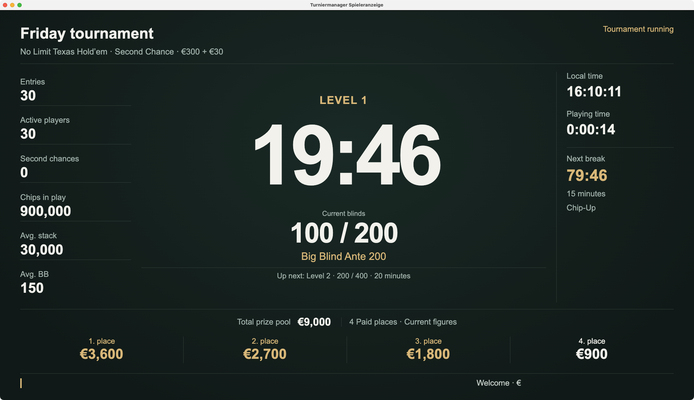
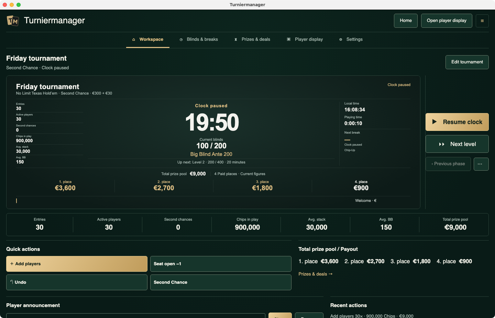

# Turniermanager Lite

**Prepare your poker tournament. Keep play organised.** Blinds, player counts, rebuys and prize money in one place. For Windows and Mac, with a separate player display.

[Website](https://turniermanager-beta.pages.dev/en/) · [Interactive demo](https://turniermanager-beta.pages.dev/en/#demo) · [Deutsch](README.md)

[Download for Mac — Apple Silicon and Intel](https://github.com/arnefranz-del/turniermanager-beta/releases/download/v0.9.0-beta.2/Turniermanager-0.9.0-beta.2-macos-universal.dmg) · [Download for Windows — x64](https://github.com/arnefranz-del/turniermanager-beta/releases/download/v0.9.0-beta.2/Turniermanager-0.9.0-beta.2-windows-x64-Setup.exe)

Free beta **0.9.0-beta.2**, released on 20 October 2026. Private and commercial evaluation is free, with no subscription or later payment obligation for this evaluation. Future versions may have different terms. [Full beta terms](BETA_TERMS.md).

Mac is ad-hoc signed and not notarized; Windows is unsigned. Your computer may show a security warning. Read the [installation guide](docs/INSTALLATION.en.md) before opening it. Keep protection enabled; do not bypass a malware or damaged-file warning.

## The player display

## The workspace

Original beta captures from 20 October 2026, using example data. The two files are byte-identical copies of the approved website images. Their origin and distinct installer identities remain documented in the [visual evidence](checks/human-visual-acceptance.json). These are screenshots of the desktop app, not the browser demo.

## Try the controls

[Try it in your browser](https://turniermanager-beta.pages.dev/en/#demo)

Start the clock, add players and rebuys, edit blinds and breaks, and check the payouts. The demo opens on the website with example data. Your input stays in the browser; reloading resets the demo.

## For your tournament night

- Templates for Freezeout, Second Chance, Re-Entry or Rebuy, with an add-on where appropriate.
- Add players, record eliminations and track rebuys without keeping participant names.
- Control the clock, levels and breaks; show the tournament on a separate screen.
- Let normal payouts update automatically from a valid saved rule.
- Work locally without an app account or internet connection, keep backups and return to active tournaments later.

First practice run: edit and save a template, load the tournament, add players, check payouts and the player display, then start the clock. [Full help](https://turniermanager-beta.pages.dev/en/help/) · [Questions & answers](docs/FAQ.md).

## Feedback

**Private, no GitHub account:** [Send feedback by email](mailto:hybrid-larval-1l@icloud.com?subject=Turniermanager%20%E2%80%94%20feedback). This opens your mail app; you send the message there. The [feedback page](https://turniermanager-beta.pages.dev/en/feedback/) has an address you can copy if no mail app is configured.

**Public, GitHub account required:** [Report a bug](https://github.com/arnefranz-del/turniermanager-beta/issues/new?template=bug.yml) · [Suggest an improvement](https://github.com/arnefranz-del/turniermanager-beta/issues/new?template=feedback.yml). General feedback needs only a message; version and operating system are optional.

In the app: **Settings → Application**. Logs and backups are not attached automatically. Do not publish real participant data, full backups or credentials. [Report security issues privately](SECURITY.md). Event support and response times are not guaranteed.

Technical details and checksums

[macOS Universal · DMG](https://github.com/arnefranz-del/turniermanager-beta/releases/download/v0.9.0-beta.2/Turniermanager-0.9.0-beta.2-macos-universal.dmg) · 231,487,943 bytes

SHA-256: `f8f8c152b67eeda20e8e85fc7835026b84cd25bbf6180eccd3e0e220913469d9`

Tested on macOS 14.7 on a physical Intel iMac and Darwin 25.6.0 on an ARM64 hosted Mac VM. The package is ad-hoc signed and not notarized. HDMI, every consumer configuration and MacBook installation are not claimed as tested.

[Windows x64 · Setup](https://github.com/arnefranz-del/turniermanager-beta/releases/download/v0.9.0-beta.2/Turniermanager-0.9.0-beta.2-windows-x64-Setup.exe) · 111,786,939 bytes

SHA-256: `e01c82ab14eb23217565d6262f1cc479de703cbac090be1f606303b3a3eac332`

Installation, normal quit and reopen, resume, backup and restoration were checked natively in a Windows Server 2025 Datacenter VM (10.0.26100, x64). The installer and app are unsigned. Captures are limited to 1024 pixels wide, with the Windows taskbar hiding the bottom announcement row. Physical Windows hardware, HDMI and native ticker movement are not fully qualified by this evidence. See the [Windows visual evidence](checks/windows-human-visual-acceptance.json) for the precise limits.

[Release & SHA-256](https://github.com/arnefranz-del/turniermanager-beta/releases/tag/v0.9.0-beta.2) · [Manifest](release-manifest.json) · [Third-party notices](THIRD_PARTY_NOTICES.md) · [Third-party sources](docs/THIRD_PARTY_SOURCES.md)

## Product documentation and rights

This repository contains product documentation, downloads and feedback. The app source remains private; it is not an open-source release of the app. Included third-party software keeps its rights: [notices](THIRD_PARTY_NOTICES.md) and [sources](docs/THIRD_PARTY_SOURCES.md).

Player profiles, check-in, seating, table balancing, PKO/bounties, satellites, remote control and synchronization between computers are not included. Each computer has its own local state.

Provider and contact: Turniermanager · Arne Franz, Rita-Maiburg-Straße 40, 70794 Filderstadt. [Email](mailto:hybrid-larval-1l@icloud.com).

Website/documentation updated: 22 October 2026. App, installers and release tag unchanged. The tag identifies public documentation and the manifest, not app source.
