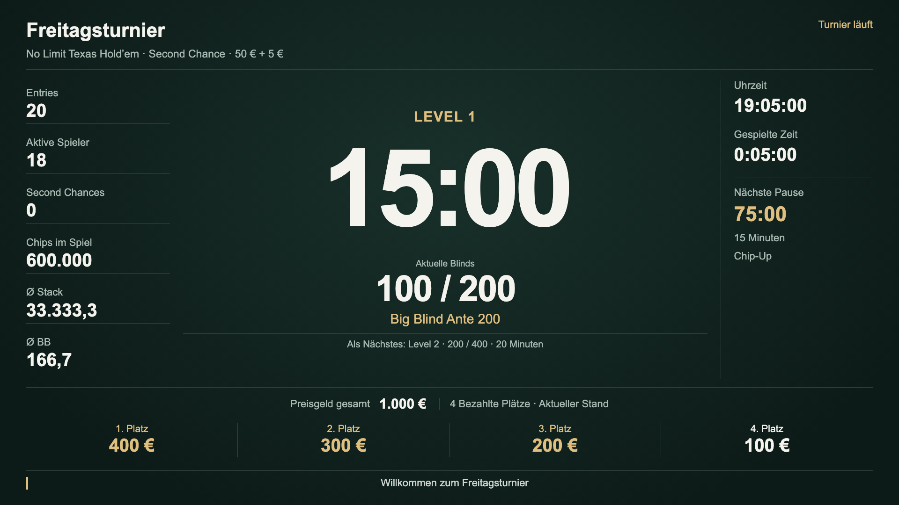
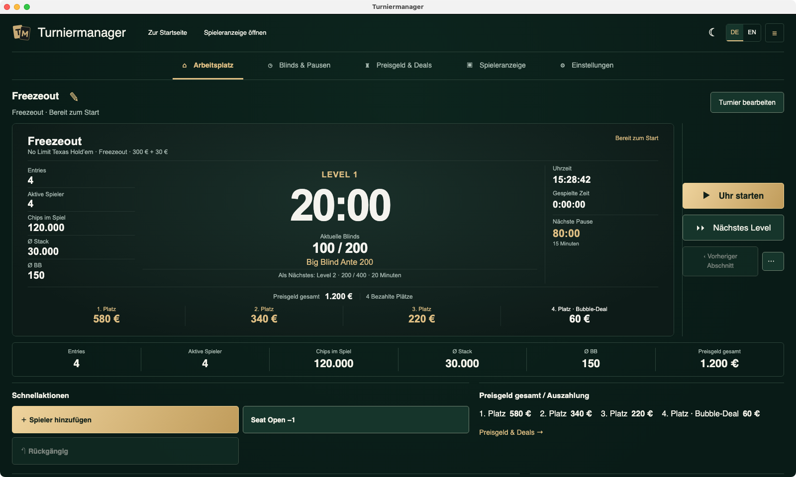

# Turniermanager Lite

**Pokerturniere vorbereiten und leiten. Für Windows und Mac.** Uhr, Spielerzahl, Preisgeld und eine Spieleranzeige für den Fernseher oder zweiten Bildschirm.

[Website](https://turniermanager-beta.pages.dev/de/) · [Interaktive Demo](https://turniermanager-beta.pages.dev/de/#demo) · [English](README.en.md)

[Für Mac herunterladen — Apple Silicon und Intel](https://github.com/arnefranz-del/turniermanager-beta/releases/download/v0.9.0-beta.2/Turniermanager-0.9.0-beta.2-macos-universal.dmg) · [Für Windows herunterladen — x64](https://github.com/arnefranz-del/turniermanager-beta/releases/download/v0.9.0-beta.2/Turniermanager-0.9.0-beta.2-windows-x64-Setup.exe)

Kostenlose Beta **0.9.0-beta.2** vom 20. Oktober 2026. Privat und gewerblich kostenlos erproben, ohne Abo oder spätere Zahlungsverpflichtung für diese Erprobung. Künftige Versionen können andere Bedingungen haben. [Vollständige Beta-Bedingungen](BETA_TERMS.md).

Mac ist ad hoc signiert und nicht notarisiert; Windows ist unsigniert. Beim Öffnen können Sicherheitswarnungen erscheinen. Lies vor dem ersten Öffnen die [Installationshilfe](docs/INSTALLATION.de.md). Schutzfunktionen eingeschaltet lassen; eine Schadsoftware- oder Beschädigungswarnung nicht umgehen.

## Die Spieleranzeige

## Der Arbeitsplatz

Echte Lite-Oberfläche, am 21. Oktober 2026 isoliert mit deutschen Beispieldaten gerendert; keine Aufnahme eines nativen App-Fensters. Die verwendeten UI-Komponenten sind gegenüber dem geprüften Beta-Code unverändert. Die PNGs wurden direkt aufgenommen und nicht nachbearbeitet. Die ursprünglichen englischen Fensteraufnahmen bleiben mit ihren [Bildnachweisen](checks/human-visual-acceptance.json) erhalten.

## Selbst ausprobieren

[Turniermanager-Beta ausprobieren](https://turniermanager-beta.pages.dev/de/#demo)

Die Website bietet eine begrenzte interaktive Vorschau mit Beispieldaten. Dort kannst du Uhr, Spielerzahlen, Rückgängig, kommende Blinds/Pausen und Prozentstaffeln ausprobieren. Alle Tabs zeigen denselben lokalen Demostand. Änderungen gelten nur für diese Vorschau. Beim Neuladen startet die Demo von vorn. GitHub zeigt diese README statisch — die Demo öffnet sich auf der Website.

## Für deinen Pokerabend

- Vorlagen für Freezeout, Second Chance, Re-Entry oder Rebuy mit passendem Add-on.
- Spieler hinzufügen, ein Ausscheiden erfassen und Nachkäufe eintragen, ohne Teilnehmernamen.
- Uhr, Level und Pausen steuern; Spieler sehen den Stand auf einem zweiten Bildschirm.
- Normale Auszahlungen automatisch anhand einer gültigen gespeicherten Regel aktualisieren.
- Lokal ohne Konto und Internet arbeiten, Sicherungen erstellen und aktive Turniere später fortsetzen.

Erster Probelauf: Vorlage bearbeiten und speichern, als Turnier laden, Spielerzahl eintragen, Auszahlungen und Spieleranzeige prüfen, Uhr starten. [Vollständige Hilfe](https://turniermanager-beta.pages.dev/de/help/) · [Fragen & Antworten](docs/FAQ.md).

## Feedback

**Privat, ohne GitHub-Konto:** [Feedback per E-Mail](mailto:hybrid-larval-1l@icloud.com?subject=Turniermanager%20%E2%80%94%20Feedback). Das öffnet dein Mailprogramm; gesendet wird erst dort. Die [Feedbackseite](https://turniermanager-beta.pages.dev/de/feedback/) zeigt die Adresse zum Kopieren, falls kein Mailprogramm eingerichtet ist.

**Öffentlich, GitHub-Konto nötig:** [Fehler melden](https://github.com/arnefranz-del/turniermanager-beta/issues/new?template=bug.yml) · [Verbesserung vorschlagen](https://github.com/arnefranz-del/turniermanager-beta/issues/new?template=feedback.yml). Allgemeines Feedback benötigt nur eine Nachricht; Version und Betriebssystem sind freiwillig.

In der App: **Einstellungen → Programm**. Keine automatischen Logs oder Backups werden angehängt. Keine echten Teilnehmerdaten, vollständigen Backups oder Zugangsdaten veröffentlichen. [Sicherheitsprobleme privat melden](SECURITY.md). Eine Betreuung während eines Turniers oder eine feste Antwortzeit ist nicht zugesagt.

Technische Details und Prüfsummen

[macOS Universal · DMG](https://github.com/arnefranz-del/turniermanager-beta/releases/download/v0.9.0-beta.2/Turniermanager-0.9.0-beta.2-macos-universal.dmg) · 231.487.943 Byte

SHA-256: `f8f8c152b67eeda20e8e85fc7835026b84cd25bbf6180eccd3e0e220913469d9`

Geprüft auf einem Intel-iMac mit macOS 14.7 und einer ARM64-Mac-CI-VM mit Darwin 25.6.0. Das Paket ist ad-hoc signiert und nicht notarisiert. HDMI, jede Consumer-Konfiguration und die Installation auf einem MacBook sind damit nicht pauschal abgenommen.

[Windows x64 · Setup](https://github.com/arnefranz-del/turniermanager-beta/releases/download/v0.9.0-beta.2/Turniermanager-0.9.0-beta.2-windows-x64-Setup.exe) · 111.786.939 Byte

SHA-256: `e01c82ab14eb23217565d6262f1cc479de703cbac090be1f606303b3a3eac332`

Installation, normales Beenden und Wiederöffnen, Wiederaufnahme, Sicherung und Wiederherstellung wurden nativ in einer Windows-Server-2025-Datacenter-VM (10.0.26100, x64) geprüft. Installer und App sind unsigniert. Die Bildschirmaufnahmen sind auf 1024 Pixel Breite begrenzt; die Windows-Taskleiste verdeckt die unterste Ankündigungszeile. Ein physischer Windows-Rechner, HDMI und die native Tickerbewegung sind damit nicht vollständig geprüft. Details stehen in den [Windows-Bildnachweisen](checks/windows-human-visual-acceptance.json).

[Release & SHA-256](https://github.com/arnefranz-del/turniermanager-beta/releases/tag/v0.9.0-beta.2) · [Manifest](release-manifest.json) · [Third-party notices](THIRD_PARTY_NOTICES.md) · [Third-party sources](docs/THIRD_PARTY_SOURCES.md)

## Produktunterlagen und Rechte

Dieses Repository enthält Produktunterlagen, Downloads und Feedback. Der App-Quellcode bleibt privat; es ist keine Open-Source-Freigabe der App. Rechte enthaltener Drittsoftware bleiben unberührt: [Hinweise](THIRD_PARTY_NOTICES.md) und [Quellen](docs/THIRD_PARTY_SOURCES.md).

Spielerprofile, Check-in, Seating, Tischbalancing, PKO/Bounty, Satellites, Remote-Steuerung und Synchronisation zwischen Rechnern sind nicht enthalten. Jeder Rechner hat seinen eigenen lokalen Stand.

Anbieter und Kontakt: Turniermanager · Arne Franz, Rita-Maiburg-Straße 40, 70794 Filderstadt. [E-Mail](mailto:hybrid-larval-1l@icloud.com).

Website-/Dokumentationsstand: 21. Oktober 2026. App, Installer und Release-Tag unverändert. Der Release-Tag bezeichnet den öffentlichen Dokumentations- und Manifeststand, keinen App-Source-Tag.
